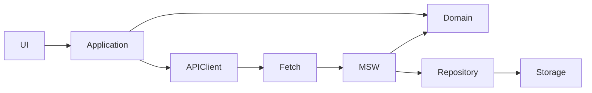

# Приложение бронирования переговорной — утверждённый план

## Текущее состояние сдачи — 2026-10-24

Приложение опубликовано: [GitHub](https://github.com/mrbushik/room-bokking),
[HTTPS-demo](https://room-bokking.vercel.app). Requirements Acceptance Audit
проверил опубликованный commit fcc1d3571970ffd34446812321239212f48c4314,
локальную и HTTPS-версии: 40 PASS, 4 PARTIAL, 0 FAIL. Функциональные требования
подтверждены; четыре PARTIAL относились к комплекту документов.
README обновлён по D03/D04/D05; AI-история дополнена реальными доступными
сообщениями по D07, личные пути отредактированы. Замеры времени и частичность
истории обозначены честно; полный хронометраж не восстанавливался.
Повтор тестов при документационном обновлении: 142/142, 10 файлов, exit 0.
Код приложения, API, архитектура и тесты не менялись.

Ниже сохранены утверждённый план и исторические записи этапов. Их прежние
статусы «публикации нет» и количества тестов относятся к моменту записи;
текущий источник статуса сдачи — README и этот раздел.

План принят запросом пользователя «PLEASE IMPLEMENT THIS PLAN» 2026-10-24.
M1 принят пользователем. По новому указанию M2–M5 выполняются последовательно
автономно: проверки, review, Progress log и отдельный коммит каждого этапа.
После M5 — независимый аудит; M6 готовится локально без публикации.

## Цель и приоритеты

SPA для одной переговорной: React + Vite + TypeScript, Tailwind CSS,
TanStack Query, Fetch, MSW и localStorage за repository.
Тестирование: Vitest + React Testing Library.

### P0

- Выбор даты, просмотр, создание, редактирование, перенос и удаление с подтверждением.
- Рабочее время 09:00–18:00; `start < end`; длительность 30–120 минут включительно.
- Нет пересечений; касание границ допустимо; при PATCH исключается собственный id.
- POST и PATCH не допускают итоговое начало в прошлом.
- Независимая серверная валидация; корректный 409 без потери черновика.
- Loading, empty, error, submitting; ошибки полей; клавиатура и адаптивность.
- Изменения только через HTTP; данные сохраняются при reload.
- Подменяемые часы; нет обязательного шага 30 минут.
- Unit- и интеграционные проверки, включая конкурентное изменение.
- README, репозиторий, проверенная deployed demo и реальная AI-переписка.

### P1

- Пропорциональная геометрия временной шкалы и дополнительная визуальная полировка.
- Подтверждение потери черновика при обычной навигации.
- Создание новой брони из черновика после PATCH → 404.
- Панель имитации конкурента; расширенная матрица браузеров и часовых поясов.

Для P0 достаточно аккуратного хронологического расписания с отметками времени.
Drag-and-drop, дополнительные сервисы и межвкладочная координация не входят в объём.

## Архитектура



- UI: отображение, ввод, доступность, вызов действий application.
- Application: черновик, запросы, мутации и клиентская валидация.
- Domain: независимые чистые правила дат, времени и бронирования.
- API client: HTTP, DTO, проверка ответов как `unknown`, типизированные ошибки.
- Mock API: проверка входящего запроса и актуального состояния, HTTP-ответ.
- Repository: чтение и сохранение демонстрационных данных.

UI, application и API client не импортируют MSW/repository. UI не использует
localStorage напрямую. Domain не зависит от React/HTTP/Storage. Связывание —
при запуске; дополнительные service layer и DI-контейнер не нужны.

### Структура

```text
public/mockServiceWorker.js
src/
  app/             App, bootstrap, QueryClient
  domain/          booking, time, bookingRules, unit-тесты
  application/     bookingQueries, controller, useNow
  api/             contracts, client, errors
  mocks/           browser, handlers, repository, HTTP-тесты
  ui/              BookingPage, DayTimeline, BookingForm
  test/            setup, fixtures, bookingFlow
  main.tsx
  styles.css
docs/               только реальная AI-история при наличии экспорта
package.json, package-lock.json
vite.config.ts, vitest.config.ts, eslint.config.js, tsconfig*.json
.env.example, README.md, PLAN.md, AGENTS.md
```

## Контракты

### Даты и правила

`Booking`: `id: string`, `date: string`, `start: string`, `end: string`, `title?: string`.
Дата — существующая календарная дата строго `YYYY-MM-DD`; время строго `HH:mm`.
Используются минуты от начала суток и полуоткрытые интервалы `[start, end)`.

- `540 <= startMinutes < endMinutes <= 1080`.
- `30 <= endMinutes - startMinutes <= 120`.
- Конфликт: `a.start < b.end && b.start < a.end` на одной дате.
- При PATCH исключается собственный id; проверяется целевая дата.
- POST/PATCH проверяют начало не раньше now. Просмотр/удаление прошлого разрешены.
- `Clock.now(): Date` внедряется; domain получает снимок аргументом.
- Mock API берёт свежий now внутри операции сохранения.
- UI обновляет часы раз в секунду и при возвращении на страницу.
- Секунды и миллисекунды учитываются: после 17:30:00.000 новый интервал не помещается.
- Выбранная дата не меняется автоматически при полуночи.
- Не использовать `new Date('YYYY-MM-DD')` или `toISOString().slice(0, 10)` для даты.

### HTTP

| Запрос | Успех |
| --- | --- |
| GET `/api/bookings?date=YYYY-MM-DD` | 200 `{ data: Booking[] }`, по началу |
| POST `/api/bookings` | 201 `{ data: Booking }`, сервер создаёт id |
| PATCH `/api/bookings/:id` | 200 `{ data: Booking }` |
| DELETE `/api/bookings/:id` | 204 без тела |

POST: date/start/end и необязательное title. PATCH: непустое подмножество этих
полей, объединяемое с актуальной записью и полностью проверяемое. id неизменяем.
`title: ''` очищает название; пробелы по краям убираются. Лимит названия не вводится.

Ошибка: `{ error: { code, message, fieldErrors? } }`;
fieldErrors содержит сообщения для date/start/end/title.

| Статус | Значение |
| --- | --- |
| 400 | JSON, структура/типы DTO, неизвестные поля, пустой PATCH, query даты |
| 415 | Неподдерживаемый Content-Type |
| 422 | Дата/время, рабочий день, длительность, порядок, прошлое |
| 404 | Отсутствующая запись |
| 409 | Пересечение с актуальной другой бронью |
| 500 | Ошибка Storage или внутренняя ошибка |

Коды: INVALID_REQUEST, VALIDATION_ERROR, BOOKING_NOT_FOUND, BOOKING_CONFLICT,
STORAGE_ERROR, INTERNAL_ERROR. Клиент отличает HTTP, сетевые и протокольные ошибки.
Предоставляет list/create/update/remove, base URL и AbortSignal для GET;
обрабатывает 204 и не показывает отмену GET как пользовательскую ошибку.

### Repository и bootstrap

Repository предоставляет чтение snapshot и синхронное изменение через callback:
актуальное чтение → применение PATCH → правила → запись → подтверждение успеха.
Между чтением и записью нет `await`; разбор тела запроса выполняется до секции.
Ключ: `room-booking:v1`, версия и массив. Отсутствующий ключ — пустой набор.
Ошибки/повреждение не приводят к сбросу или ложному успеху. Исторические записи
при чтении не отклоняются из-за запрета прошлого.

- Development и demo: `VITE_API_MODE=mock`; будущий backend: `real` и base URL.
- Неизвестный/отсутствующий режим — явная ошибка конфигурации.
- В mock-режиме дождаться `worker.start()` до первых запросов.
- При отказе регистрации показать ошибку и повтор, без fallback к backend.
- Гарантия конкурентности — одна вкладка; нет общей серверной истины,
  межвкладочной атомарности и синхронизации браузеров/устройств.
- Нет БД и миграций; автоматическая миграция Storage не нужна.

### Дата, черновик и запросы

Одна выбранная дата для формы/расписания/payload. Смена даты сохраняет время и
название; перенос сохраняет id. При успехе/409 выбран целевой день. Отмена очищает
черновик, сохраняя день. Refetch не сбрасывает поля; старый GET не попадает под
новую дату. Controller и GET остаются смонтированными независимо от формы.

Ключ: `['bookings', date]`. Сохранение недоступно при невалидной дате или отсутствии
первоначальных данных. Во время отправки запрещены повторная мутация и смена
контекста; GET не отключается.

Успех записи фиксируется независимо от загрузки: очистить сохранённый черновик,
инвалидировать `['bookings']` с `refetchType: 'active'`, передать `throwOnError: true`
вторым аргументом и перехватить GET-ошибку внутри callback. Показать «Сохранено,
но обновить расписание не удалось»; повторять только GET. Неактивные дни только
инвалидируются. При приостановленном/неуспешном GET не утверждать свежесть данных.

409 сохраняет исходный конфликт и поля, запускает защищённый refetch; его ошибка
показывается отдельно. Фоновый сбой не размонтирует форму и не скрывает старые данные.
Нет optimistic updates и повторов мутаций. GET: один повтор для сети/5xx,
без повторов 4xx; в тестах повторы отключены.

### Ручной сценарий 409

Расписание demo: `refetchOnWindowFocus: false`, без polling; часы на focus обновляются.
В README добавить готовый Fetch-пример для той же вкладки:

1. Пустой будущий день; форма 10:00–11:00, не отправлять.
2. POST через консоль: та же дата, 10:30–11:00, «Конкурирующая бронь».
3. Проверить 201; не обновлять Query-кэш/страницу.
4. Отправить исходную форму: настоящий 409.
5. Проверить список и сохранность всех полей.
6. Исправить на 11:00–12:00, сохранить; затем удалить тестовые записи через UI.

Автотест создаёт конкурента вторым API client через обычный handler,
а не подставляет готовый 409.

## Milestones

Каждый следующий этап зависит от успешных проверок, review и коммита предыдущего.
Отдельное подтверждение перехода M2–M5 больше не требуется (указание пользователя).

- [x] **M1 — Setup, 20–30 минут.** Конфиги, scripts, main, стили, test/setup,
  PLAN и AGENTS. Приёмка: dev, TS, lint, build, конфигурация Vitest.
- [x] **M2 — Domain, 40–50 минут.** booking/time/bookingRules и unit-тесты.
  Приёмка: все правила, границы и два часовых пояса.
- [x] **M3 — API и mocks, 50–65 минут.** api/*, mocks/*, worker, bootstrap,
  HTTP/repository-тесты. Приёмка: CRUD/Fetch, валидация, persistence,
  конкурентные 201/409, ошибка Storage, браузерный worker.
- [x] **M4 — UI, 55–70 минут.** Controller, hooks, BookingPage/DayTimeline/BookingForm.
  Приёмка: одна дата, CRUD, перенос, базовые интеграционные тесты.
- [x] **M5 — Ошибки и UX, 45–60 минут.** Refetch/409, адаптивность, клавиатура,
  интеграционные тесты. Приёмка: исправление и повтор, сохранность черновика,
  GET-ошибка после успеха не отменяет запись.
- [x] **M6 — Сдача, 30–40 минут (плановая оценка).** README, реальная AI-история, review, размещение.
  Приёмка: все проверки, браузерный reload, рабочая demo и ссылки.
  Репозиторий и demo опубликованы, HTTPS-проверки выполнены; документы обновлены.
  AI-экспорт частичный, полный хронометраж неизвестен — ограничения раскрыты в README.

Оценка P0: 240–315 минут + 30–45 минут резерва. Это прогноз реализации,
не измеренный результат/гарантия общего времени задания. Ранее не измеренное
планирование не восстанавливается как точное. При лимите — остановка и честная
фиксация остатка; P1 только после P0 и при оставшемся времени.

## Проверки

- Domain: 09:00–09:30, 17:30–18:00, 29/30/120/121 минут, равное/обратное время,
  09:10–09:40, касание/пересечения/вложение, собственный id, другая дата,
  прошлое/равенство now/17:30/полночь, форматы и границы календаря.
- HTTP/repository: CRUD и статусы, запросы без React, актуальный PATCH,
  конкурентные POST, Storage failure, повторное чтение новым repository.
- React: состояния/повтор GET, CRUD/перенос/подтверждение удаления, настоящий
  POST/PATCH → 409, поля и повтор, успех мутации + GET failure, неактивный день,
  задержанный старый GET и смена временной границы без потери черновика.
- Изолировать Storage, QueryClient и Clock; необработанный HTTP — ошибка теста.
- Каждый этап с кодом: `npm run typecheck`, `npm run lint`, `npm run build`.
- Только M1: `npm run test:run -- --passWithNoTests`.
- M2: `TZ=Asia/Tbilisi npm run test:run -- src/domain` и
  `TZ=America/Los_Angeles npm run test:run -- src/domain`.
- M3: тесты src/mocks; M4–M5: src/test.
- M6: `npm ci`, полный test:run, `npm run build -- --mode demo`, `npm run preview`.
- Браузер: mobile/desktop, клавиатура, production-worker, CRUD/reload.
- После публикации повторить smoke на HTTPS-demo. Local/preview не доказывают
  hosted-ready. CI и нагрузочные гарантии не входят в обязательный объём.

## Risk register

| Риск | Мера |
| --- | --- |
| Устаревшее расписание | Повторная серверная проверка, 409 и сохранение полей |
| GET failure после записи | Отдельное предупреждение и повтор только GET |
| MSW startup failure | Блокировать запросы, ошибка и повтор bootstrap |
| Storage failure | Не показывать успех и не сбрасывать данные |
| Межвкладочные гонки | Документировать отсутствие гарантий |
| Таймбокс | Не выполнять P1, остановиться и описать остаток |
| Нет размещения/AI-истории | Не объявлять внешнюю сдачу завершённой |

## Decision log

- Прямо заданы исходным пользовательским запросом: стек и разделение слоёв,
  бизнес-правила, независимая серверная проверка и сохранение черновика при 409.
- Итоговый интервал POST/PATCH, локальный пояс, гарантия одной вкладки и перенос
  между датами приняты в составе утверждённого плана. Отдельное индивидуальное
  подтверждение этих допущений не заявляется.
- Приняты в составе этого плана запросом реализации: одна дата, защищённый refetch,
  отсутствие focus-refetch расписания demo, bootstrap, русский UI, пустые данные,
  одинаковые правила всех дней, точное now, нативное подтверждение и Vercel.
- Отдельного разрешения на публикацию ещё нет: сначала review готового результата.
- Для внешней сдачи M6 нужны Git remote и доступ к размещению. Реальный локальный
  журнал текущей сессии найден; доступные видимые сообщения экспортированы частично.
- AI: реальный экспорт/ссылка, исходный порядок; нет искусственной реконструкции.
  Частичный материал обозначается; Decision log не заменяет историю.

## Definition of Done

- [ ] Все P0 выполнены; невыполненное явно указано.
- [x] Правила независимо проверяются mock API; CRUD через HTTP; reload сохраняет данные.
- [x] Ошибки не стирают черновик; GET failure не повторяет успешную запись.
- [x] Дата согласована; ручной 409 воспроизводится.
- [x] Typecheck/lint/tests/build проходят; браузер/клавиатура/адаптивность проверены.
- [ ] Deployed demo проверена отдельно; README/ссылки/подлинная AI-история готовы.
- [x] M1 принят; M2–M5 выполнены автономно по изменённому указанию пользователя.
- [x] README, локальная demo-сборка, deploy-конфигурация и подлинный частичный AI-экспорт подготовлены.
- [ ] Публикация подтверждена пользователем; добавлены внешние URL; HTTPS-smoke выполнен.

## Progress log

| Дата | Этап | Факт и проверки | Время | Статус |
| --- | --- | --- | --- | --- |
| 2026-10-24 | Планирование | ТЗ и запрос изучены, два review выполнены | Не измерялось | План принят запросом реализации |
| 2026-10-24 | M1 | Setup, строгий TS, Tailwind, Query provider, ESLint, Vitest/RTL setup, env, PLAN/AGENTS/README и lockfile. Финальные typecheck/lint/build/Vitest config — exit 0; dev открыт в браузере без ошибок/предупреждений | ≈11 минут настенного времени, 10:50–11:01 Asia/Tbilisi; включает установку/ожидание. Активное время отдельно не измерялось | Реализован, ожидает review |
| 2026-10-24 | Независимый review M1 | Прочитаны все файлы M1 и lockfile metadata; исправлен избыточный диапазон Node, повторены проверки | Отдельно не измерялось | Исправлено, ожидает пользовательского review |
| 2026-10-24 | Git + M2 | M1 принят; Git main и M1-коммит 7d435db. Domain: 61 тест, оба TZ прогона, typecheck/lint/build exit 0. Review: строгие форматы дополнены запретом завершающего перевода строки | 11:09:13–11:11:50 Asia/Tbilisi (2м37с, включая Git-подготовку) | Проверен, переход к M3 |
| 2026-10-24 | M3 | 25 HTTP/repository тестов, всего 86; typecheck/lint/build exit 0. Браузер: worker активен, POST 201, реальный конфликт 409, после reload запись сохранилась, PATCH 200, DELETE 204; удалена только тестовая запись. Review: учтён MSW 3 onUnhandledFrame, runtime DTO и история в Storage проверены | 11:11:50–11:17:07 (5м17с настенного времени) | Проверен, переход к M4 |
| 2026-10-24 | M4 | Основной UI и controller, одна дата, CRUD/перенос/подтверждение. 88 тестов (2 UI), typecheck/lint/build exit 0. Браузерная форма создала 09:10–09:40; тестовая запись удалена через UI с подтверждением. Review: запрос остаётся активным, черновик отделён от кэша, слой UI не читает Storage | 11:17:07–11:24:36 (≈7м29с настенного) | Проверен, переход к M5 |
| 2026-10-24 | M5 | 104 теста (61 domain, 25 HTTP/repository, 18 React); typecheck/lint/build exit 0. Реальный браузерный 409 сохранил форму; исправленный интервал сохранён клавиатурой. Проверены 320 и 1280 px. Review: исправлен фокус серверной ошибки после снятия disabled; усилен тип команды PATCH. Тестовые записи удалены | 11:24:36–11:44:59 (20м23с настенного) | Проверен; далее независимый аудит |
| 2026-10-24 | Аудит после M5 | Фактический diff и все production-модули прочитаны повторным проходом; Critical/Major не обнаружены. Исправлены Minor: AbortError тела ответа и ошибочная подсказка при paused GET. Добавлены bootstrap/paused/cancellation проверки. Всего 113 тестов; typecheck/lint/build/diff-check exit 0. Подробности docs/REVIEW.md | 11:45–11:48 (≈3м настенного) | Проверен; далее M6 |
| 2026-10-24 | M6, локальная подготовка | README, vercel.json, реальная частичная AI-история и экспортёр. npm ci из offline cache; 113 тестов; domain по 61 в Tbilisi/Los_Angeles; typecheck/lint/diff-check и demo build exit 0. Браузер production preview: активный worker, CRUD, перенос с тем же id, reload, настоящий 409 с сохранением формы; 320/1280 px без переполнения. Полностью перечитаны 3 страницы исходного PDF — обязательная функциональность покрыта | 11:48–11:57:35 (≈10м настенного) | Публикация запрещена до подтверждения |
| 2026-10-24 | M6, дополнительный аудит | Выявлен Major MSW 3.0.3 после простоя; механизм подтверждён 3 падающими тестами штатного worker. Pin 2.15.0 и штатная регенерация; 116 тестов, typecheck/lint, обычная/demo сборки, оба TZ, чистый npm ci по новому lockfile — exit 0. Через 393 секунды без reload/реактивации GET JSON; реальный 409 сохраняет форму; исправление, длительное подтверждение удаления, reload/PATCH/DELETE работают. Все собственные записи удалены | 11:57–12:11 (≈14м, включая 6,5м длительной проверки) | Major исправлен; внешняя сдача ожидает пользователя |
| 2026-10-24 | Исправление выбора времени по записи экрана | Нативный time picker заменён полем ЧЧ:ММ и списком каждой минуты в пределах рабочего дня; прокрутка не выбирает значение, подтверждение кликом/Enter, Escape/blur закрывает список. Ввод 0917 преобразуется в 09:17. 124 теста / 9 файлов, typecheck/lint, build и demo build — exit 0. Локальный production preview: прокрутка сохранила 14:17 и 15:17 при неизменном scrollY, окончание ограничено 18:00, Enter выбрал 15:18; 320 px без горизонтального переполнения. Самостоятельный критический review: фокус ошибок, disabled, сохранение черновика, runtime domain/API-валидация сохранены; прокручивается только контейнер списка. Изменение BookingPage из параллельной работы исключено из коммита | Отдельно не измерялось | Локально проверено, публикации нет |
| 2026-10-24 | Переработка UX выбора времени | По замечанию пользователя минутный список заменён колонкой часов и сеткой 00–59 с явным подтверждением, SVG-стрелками и закрытием. Все минуты видны без прокрутки; keyboard/blur/Escape и ручной ввод сохранены. 125 тестов / 9 файлов, typecheck/lint, обычная/demo сборки и diff-check — exit 0. Production preview: отдельный выбор 14 и 17 не меняет поле до подтверждения; 18:00 — единственный доступный вариант 18-го часа; на 320×740 popup целиком внутри viewport, clientHeight=scrollHeight=460, стрелки строго по центру (dx=dy=0). Критический review выполнен самостоятельно, слои и данные не менялись | Отдельно не измерялось | Локально проверено, публикации нет |
| 2026-10-24 | Крутилки времени по уточнению пользователя | Сетка заменена двумя колёсами: нативная прокрутка, CSS snap, центральная полоса, 5 видимых строк. React не перерисовывается на каждый scroll; выбор фиксируется после остановки, подтверждение ожидает завершения обеих колонок. 128 тестов / 10 файлов, typecheck/lint, обе сборки и diff-check — exit 0. Браузер: минуты 17→33 зафиксированы на scrollTop=1452; pageScroll=77 неизменен; часы→17 ограничили минуты до 30, подтверждение дало 17:30. При 320×740 popup 256×366 помещается целиком. Самостоятельный критический review: отмена таймеров, свежие callbacks и независимость колёс проверены | Отдельно не измерялось | Локально проверено, публикации нет |
| 2026-10-24 | Окончание зависит от начала | Общие domain-константы 30/120 и endTimeRange; controller передаёт только допустимый диапазон окончания. До корректного начала окончание disabled; смена начала сохраняет подходящее окончание и очищает вышедшее за новые границы. Два UI-регрессионных теста сначала упали, после исправления прошли. Всего 142 теста / 10 файлов; typecheck/lint, обычная/demo сборки и diff-check — exit 0; domain по 71 тесту в Tbilisi/Los_Angeles. Локальный браузер: 12:48→13:18–14:48, подтверждено 14:48; смена на 17:30 очистила поле, оставив только 18:00. Критический review: manual/API-валидация сохранена, refetch/смена даты не очищают черновик | Отдельно не измерялось | Локально проверено, публикации нет |

### Наблюдение M5 для финальной браузерной проверки

В dev-сессии один раз запросы перестали перехватываться MSW (GET вернул HTML,
DELETE — сетевой 404). После reload восстановлены JSON/HTTP-операции; повтор
удаления с почти 50-секундным подтверждением прошёл. Причина не установлена;
Первоначальный smoke M6 прошёл, но позднее production preview воспроизвёл
тот же сбой после простоя. См. ниже Major и его регрессионную проверку.

### Дополнительный Major, обнаруженный в M6

MSW 3.0.3 терял активацию клиента через несколько минут при активной регистрации:
GET возвращал HTML. Диагностический MOCK_ACTIVATE сразу восстановил JSON.
В штатном worker уведомления оставляют незавершённый `event.waitUntil`;
3 новых теста lifetime упали на прежнем worker. Минимальное исправление —
pin MSW 2.15.0, его onUnhandledRequest и штатный worker CLI, без vendor-патчей,
смены архитектуры и повторов мутаций. На новом worker все 116 тестов проходят.
Повторные typecheck/lint, оба TZ, обычная/demo сборки и чистый npm ci — exit 0.
Длительная браузерная проверка фиксируется в docs/REVIEW.md.

### Доказательства M1

- `npm run typecheck` — exit 0.
- `npm run lint` — exit 0, без предупреждений.
- `npm run build` — exit 0; Vite 8.3.5, 62 модуля, создан `dist`.
- `npm run test:run -- --passWithNoTests` — exit 0, **0 тестов**. Это приёмка
  конфигурации M1, а не проверка бизнес-логики или API.
- `npm ls --depth=0` — exit 0; точные версии в package.json/package-lock.json.
- Аудит npm при последней установке — 0 найденных уязвимостей на момент проверки.
- `npm run dev -- --port 5173 --strictPort` — сервер запущен на
  http://127.0.0.1:5173/. Страница открыта браузерным инструментом: заголовок
  отображается, язык ru, Tailwind-стили применены; после повторного открытия
  0 console errors / 0 warnings.
- Первичная загрузка выявила 404 favicon; добавлена локальная SVG-иконка,
  повторное открытие страницы прошло без ошибок.
- В sandbox npm получил ENOTFOUND; установка выполнена с разрешённым сетевым доступом.
- ESLint 9 сообщил о прекращении поддержки: проверены peerDependencies плагинов,
  установлен совместимый ESLint 10.13.0; линтер прошёл.
- Предупреждение Vite о расширении config-импорта устранено явным `.ts`;
  повторный запуск Vitest прошёл без предупреждения.
- MSW 3.0.3 установлен, но handlers/worker/bootstrap появятся в M3. Нет доказательств
  работы mock API, бронирований, persistence, UI-интеграций или deployed demo.
- M2 не начат: остановка на review по утверждённому milestone gate.

### Независимый implementation review M1

- Каталог изначально был пуст; Git пока не инициализирован. Прочитаны все исходники,
  конфиги и документы M1; дополнительно просмотрены no-index diff новых package.json,
  vitest.config.ts и main.tsx относительно пустого файла. Чужие файлы не удалялись.
- Найдено несоответствие engine range: проект разрешал Node >=22.12.0,
  но jsdom 30.1.3 требует ^22.22.2 в ветке 22, ESLint 10 требует ^22.13.0.
  Минимальная правка: проект объявляет ^22.23.2 (проверенная ветка Node 22),
  синхронизированы package-lock.json и README; .nvmrc остаётся 22.23.2.
- Проверены равенство manifest/lockfile (engines/dependencies/devDependencies),
  совместимость всех объявленных в lockfile Node engines с текущим v22.23.2
  и исключение неподдерживаемого 22.12.0 из диапазона проекта — все проверки прошли.
- В review typecheck и lint — exit 0. После правки build, Vitest config (0 тестов)
  и npm ls — exit 0. Версии зависимостей и прикладной код не менялись.
- Других существенных проблем в объёме M1 не найдено. Полное приложение, чистая
  переустановка npm ci, CI, deployed demo, API/persistence и нагрузка этим review
  не проверены. M2 не начат; автоматический review не заменяет подтверждение пользователя.

### Граница локальной подготовки M6

12:12:30 Asia/Tbilisi 2026-10-24: локальные задачи выполнены, README и deploy-config
подготовлены; AI-экспорт реальный и частичный. M2–M6: ≈63 минут настенного
времени с 11:09:13, включая Git, аудит и длительную проверку. M1 ≈11 минут отдельно.
Финальный коммит/ответ после этой границы не входят в замер. M6 полностью
не закрыт: нет публикации/внешних ссылок/HTTPS-smoke, ожидается пользователь.

### Повторный implementation review после M6

2026-10-24, 12:13:53–12:16:35 Asia/Tbilisi (≈3м до границы замера, без
финального оформления): actual diff и окружающий код проверены. Новый Minor
в API client: сбой потока после headers классифицировался как protocol и
не повторялся при GET. Сначала воспроизведён падающим тестом, затем исправлен;
добавлена проверка отсутствия retry для malformed JSON. 118 тестов / 8 файлов,
typecheck/lint, обычная/demo сборки и diff-check проходят. Архитектура/контракты/
Storage-формат не менялись. Новых Critical/Major нет. Браузер/TZ повторно не
запускались в этом проходе; CI/deploy/provider/load не проверялись.

### Финальная стабилизация перед публикацией — 2026-10-24

- Подтверждённый Minor закрыт минимально: открытый TimeField закрывается на
  resize/orientationchange, возвращает фокус и сохраняет подтверждённое время.
  Два регрессионных теста проверяют отсутствие неявного применения и повторное открытие.
- Существующее пользовательское удаление footer в BookingPage сохранено и входит
  в проверенную сборку. Других исходных незакоммиченных изменений не было.
- После npm ci: typecheck, lint, npm run test -- --run (130 тестов / 10 файлов),
  npm run build -- --mode demo — exit 0. npm ci: 295 пакетов, audit 0 уязвимостей.
  Первый sandbox-запуск npm ci завершился ошибкой npm/записи лога; повтор с доступом
  к npm-кэшу успешен. Lockfile и manifest совпадают; зависимости не менялись.
- Изолированный Chromium, production preview: desktop/mobile 1280/320 без
  горизонтального переполнения; resize с открытым picker, orientationchange,
  повторное открытие в 320×800 и 800×320; CRUD, перенос, reload, удаление/отмена,
  настоящий HTTP 409 с сохранением полей и успешным исправлением; клавиатура/wheel.
  MSW после 35 секунд простоя: GET 200. Необработанных JS-ошибок нет; единственное
  console.error — ожидаемое сетевое сообщение Chrome о HTTP 409. Первый строгий
  smoke завершился exit 1 из-за этого сообщения; повтор с отдельной классификацией
  ожидаемого 409 — exit 0. Продуктовые ошибки консоли не подавлялись.
- Критический review diff: подписки снимаются при закрытии/unmount; бизнес-правила,
  API и формат Storage не менялись. Новых подтверждённых дефектов нет.
- README актуализирован. Проверены vercel.json (demo build/dist), .env.demo (mock),
  наличие dist/mockServiceWorker.js, ignore-правила и отслеживаемые публичные env.
  Поиск типовых токенов/private keys в отслеживаемых файлах совпадений не дал.
- Замер: 12:44:01–12:48:25 Asia/Tbilisi, 4м24с до окончания проверок; последующее
  оформление документации/коммита/ответа не включено. Общий замер всех прошлых
  доработок не восстанавливался.
- GitHub/Vercel не публиковались, push не выполнялся. Для внешней сдачи остаются
  разрешение и целевой remote/проект, актуализация подлинного AI-экспорта,
  публикация и HTTPS-smoke. CI/cross-browser не проверены в этой стабилизации.

### Документационный пакет после Requirements Acceptance Audit — 2026-10-24

D03/D04: актуальные публичные ссылки, статус публикации и перечень P1; D05:
таблица реальных замеров (≈81 мин учтённых этапов, полный итог неизвестен);
D07: исходные 51 сообщение сверены с журналом, добавлены доступные сообщения
пяти пользовательских сессий и текстовые вложения, обозначены фильтрация,
редакция личных путей и частичность. Проверка типовых секретов и контактных
данных совпадений не дала. Повторный test:run: 142/142 в 10 файлах, exit 0.
Дополнительный глобальный review не выполнялся. Время этого обновления отдельно
не измерялось. Изменения публикуются отдельным документационным коммитом по
прямому запросу пользователя; приложение и тесты не изменены.
